# Use Case Diagram - Smart Restaurant Management System

Diagram ini menggambarkan apa yang dapat dilakukan oleh setiap aktor terhadap
sistem. Aktor utama berupa pelanggan yang memindai QR Code, serta staff yang
masuk ke aplikasi.

## Aktor

| Aktor | Deskripsi |
|---|---|
| **Pelanggan** | Konsumen yang memindai QR Code di meja lalu memesan tanpa harus login |
| **Kasir** | Staff-front of house yang mencatat transaksi POS dan menerima pembayaran |
| **Dapur** | Staff kitchen yang mengubah status pesanan pada Kitchen Display |
| **Manajer** | Mengawal laporan, melakukan approval, dan memproses refund |
| **Admin** | Mengelola user, role, permission, dan konfigurasi sistem |
| **Owner** | Melihat dashboard bisnis dan laporan |

> **Catatan Fase:** Modul Inventory dan Procurement (stok bahan baku, purchase
> request, purchase order) masih konseptual di blueprint. Use case-nya tetap
> digambarkan agar rancangan lengkap, namun **belum diimplementasikan** pada
> kode Fase 1-3 ini.

## Diagram

```mermaid
graph LR
    subgraph Aktor
        PELANGGAN[Pelanggan]
        KASIR[Kasir]
        DAPUR[Dapur]
        MANAJER[Manajer]
        ADMIN[Admin]
        OWNER[Owner]
    end

    subgraph Auth
        UC1((Masuk))
        UC2((Lihat menu QR))
    end

    subgraph Ordering
        UC3((Pindai QR meja))
        UC4((Pilih produk))
        UC5((Kelola keranjang))
        UC6((Kirim pesanan))
        UC7((Bayar pesanan))
        UC8((Lacak status pesanan))
    end

    subgraph POS
        UC9((Buka transaksi POS))
        UC10((Terima pembayaran))
        UC11((Cetak struk))
        UC12((Void / batalkan))
    end

    subgraph Dapur
        UC13((Lihat papan pesanan))
        UC14((Ubah status pesanan))
    end

    subgraph AdminMenu
        UC15((Kelola kategori))
        UC16((Kelola produk))
        UC17((Kelola varian & addon))
        UC18((Tandai produk habis))
    end

    subgraph Meja
        UC19((Kelola meja))
        UC20((Terbitkan QR Code))
    end

    subgraph Laporan
        UC21((Lihat dashboard))
        UC22((Lihat laporan penjualan))
    end

    subgraph Keuangan
        UC23((Catat pembayaran))
        UC24((Proses refund))
    end

    subgraph RBAC
        UC25((Kelola user))
        UC26((Kelola role & permission))
    end

    %% Relasi Pelanggan
    PELANGGAN --> UC3
    PELANGGAN --> UC2
    PELANGGAN --> UC4
    PELANGGAN --> UC5
    PELANGGAN --> UC6
    PELANGGAN --> UC7
    PELANGGAN --> UC8

    %% Relasi Kasir
    KASIR --> UC1
    KASIR --> UC9
    KASIR --> UC10
    KASIR --> UC11
    KASIR --> UC12
    KASIR --> UC4
    KASIR --> UC5

    %% Relasi Dapur
    DAPUR --> UC1
    DAPUR --> UC13
    DAPUR --> UC14

    %% Relasi Manajer
    MANAJER --> UC1
    MANAJER --> UC22
    MANAJER --> UC24
    MANAJER --> UC23
    MANAJER --> UC21

    %% Relasi Admin
    ADMIN --> UC1
    ADMIN --> UC15
    ADMIN --> UC16
    ADMIN --> UC17
    ADMIN --> UC18
    ADMIN --> UC19
    ADMIN --> UC20
    ADMIN --> UC25
    ADMIN --> UC26

    %% Relasi Owner
    OWNER --> UC1
    OWNER --> UC21
    OWNER --> UC22
```

## Relasi <<include>>

Beberapa use case memakai use case lain. Contoh: **Bayar pesanan**
(UC7) selalu dilakukan setelah **Kirim pesanan** (UC6), karena order harus
ada sebelum pembayaran dicatat.

| Use Case | Include |
|---|---|
| UC6 Kirim pesanan | UC4 Pilih produk, UC5 Kelola keranjang |
| UC7 Bayar pesanan | UC6 Kirim pesanan |
| UC10 Terima pembayaran | UC9 Buka transaksi POS |
| UC14 Ubah status pesanan | UC13 Lihat papan pesanan |
| UC26 Kelola role & permission | UC1 Masuk |

## Relasi <<extend>>

| Use Case | Diperluas oleh |
|---|---|
| UC4 Pilih produk | UC5 Kelola keranjang (opsional) |
| UC12 Void / batalkan | UC10 Terima pembayaran (jika sudah dibayar) |

## Matriks Aktor vs Use Case

| Use Case | Pelanggan | Kasir | Dapur | Manajer | Admin | Owner |
|---|:-:|:-:|:-:|:-:|:-:|:-:|
| Masuk | | ✓ | ✓ | ✓ | ✓ | ✓ |
| Pindai QR meja | ✓ | | | | | |
| Lihat menu QR | ✓ | ✓ | | ✓ | ✓ | |
| Kirim pesanan | ✓ | ✓ | | | | |
| Bayar pesanan | ✓ | ✓ | | | | |
| Lacak status pesanan | ✓ | ✓ | ✓ | ✓ | ✓ | ✓ |
| Transaksi POS | | ✓ | | | | |
| Void / batalkan | | ✓ | | ✓ | | |
| Papan dapur | | | ✓ | ✓ | | |
| Ubah status pesanan | | | ✓ | ✓ | | |
| Kelola menu | | | | | ✓ | |
| Kelola meja & QR | | | | ✓ | ✓ | |
| Proses refund | | | | ✓ | ✓ | |
| Dashboard & laporan | | | | ✓ | ✓ | ✓ |
| Kelola user & role | | | | | ✓ | |
