# Activity Diagram - Customer Ordering (QR)

Alur pelanggan memindai QR Code di meja, memilih menu, dan mengirim pesanan
tanpa harus login ke aplikasi.

## Diagram Utama

```mermaid
flowchart TD
    START([Pelanggan datang ke meja]) --> SCAN[/"Memindai QR Code<br/>pada meja"/]

    SCAN --> RESOLVE{"Server membaca<br/>token QR"}

    RESOLVE -->|Token valid| SHOW_MENU["Tampilkan daftar kategori<br/>dan produk"]
    RESOLVE -->|Token tidak valid<br/>atau sudah dicabut| INVALID["Tampilkan pesan:<br/>QR tidak valid"]

    INVALID --> END_INVALID([Selesai - minta bantuan kasir])
    SHOW_MENU --> BROWSE{"Pelanggan<br/>membaca menu"}

    BROWSE -->|Mencari kategori| FILTER["Saring produk<br/>berdasarkan kategori"]
    BROWSE -->|Mencari nama| SEARCH["Saring produk<br/>berdasarkan kata kunci"]
    FILTER --> ADD
    SEARCH --> ADD

    ADD["Pelanggan memilih produk"] --> CHOOSE{"Produk punya<br/>varian atau addon?"}
    CHOOSE -->|Ya| PICK["Pilih varian<br/>dan addon yang diinginkan"]
    CHOOSE -->|Tidak| QTY1["Tentukan jumlah"]
    PICK --> QTY1

    QTY1 --> CART["Tambahkan ke keranjang"]
    CART --> CHECK_STOCK{"Stok produk<br/>masih tersedia?"}

    CHECK_STOCK -->|Habis| WARN["Tampilkan peringatan<br/>produk kosong"]
    WARN --> SHOW_MENU
    CHECK_STOCK -->|Tersedia| MORE

    MORE{"Lanjut<br/>belanja?"}
    MORE -->|Ya| ADD
    MORE -->|Tidak, buka keranjang| VIEW_CART["Tampilkan isi keranjang"]

    VIEW_CART --> EDIT{"Perlu ubah?"}
    EDIT -->|Ubah jumlah| QTY1
    EDIT -->|Hapus item| VIEW_CART
    EDIT -->|Tidak| FILL_INFO

    FILL_INFO["Isi nama dan nomor HP<br/>(opsional)"] --> NOTES["Tulis catatan untuk dapur<br/>(opsional)"]
    NOTES --> SUBMIT["Tekan Kirim Pesanan"]

    SUBMIT --> CONFIRM{"Konfirmasi pesanan?"}
    CONFIRM -->|Batal| VIEW_CART
    CONFIRM -->|Ya| VALIDATE

    VALIDATE{"Server memvalidasi:<br/>- token QR<br/>- produk masih aktif<br/>- harga dihitung ulang"}
    VALIDATE -->|Gagal| ERROR["Tampilkan pesan error<br/>yang jelas"]
    ERROR --> VIEW_CART
    VALIDATE -->|Berhasil| TRANSACTION

    TRANSACTION["Buat order dalam<br/>transaksi database"] --> CALC["Hitung subtotal, pajak,<br/>service charge, total"]
    CALC --> SAVE["Simpan order, item,<br/>dan riwayat status"]
    SAVE --> MEJA["Tandai meja sebagai<br/>terisi"]
    MEJA --> KITCHEN_NOTIF["Kirim notifikasi ke dapur<br/>(Socket.IO)"]
    KITCHEN_NOTIF --> REDIRECT["Redirect ke halaman lacak pesanan"]
    REDIRECT --> END_OK([Pesanan masuk dapur])

    %% Error path
    SERVER_ERROR{"Kesalahan server?"} -.->|Ya| GENERIC["Tampilkan pesan umum<br/>dan minta coba lagi"]
```

## Penjelasan Singkat

1. **QR hanya membawa token.** Pelanggan memindai QR, server mencocokkan token
   ke tabel `table_qr_codes`. Tidak ada harga atau data menu yang ikut
   terbawa di dalam QR.
2. **Harga dihitung ulang di server.** Nilai harga yang tampil di browser hanya
   perkiraan. Saat pesanan dikirim, server mengambil harga terbaru dari
   database sehingga manipulasi harga dari sisi klien tidak berhasil.
3. **Satu transaksi database.** Pembuatan order, item, dan riwayat status
   berjalan dalam satu transaksi. Bila salah satu item gagal, seluruh order
   dibatalkan agar tidak ada pesanan setengah jadi.
4. **Notifikasi realtime.** Setelah order tersimpan, event Socket.IO dikirim ke
   ruang `kitchen` sehingga papan dapur langsung menampilkan pesanan baru.

## Validasi di Server

| Aturan | Pesan Error |
|---|---|
| Token QR tidak ditemukan | "QR meja tidak valid atau sudah dicabut." |
| Produk tidak ditemukan | "Produk #X tidak ditemukan." |
| Produk nonaktif | "Produk '...' sudah tidak tersedia." |
| Produk habis | "Produk '...' sedang kosong." |
| Varian tidak milik produk | "Varian yang dipilih tidak tersedia untuk produk ini." |
| Addon tidak milik produk/kategori | "Addon '...' tidak bisa dipilih untuk produk '...'." |
| Keranjang kosong | "Keranjang masih kosong." |
| Diskon diminta tamu | Diskon diabaikan, hanya staff yang boleh memberi diskon |