# Activity Diagram - POS / Kasir

Alur kasir mencatat transaksi langsung dari meja atau take away, lalu
menerima pembayaran dan mencetak struk.

## Diagram

```mermaid
flowchart TD
    START([Kasir login]) --> AUTH{"Login berhasil?"}
    AUTH -->|Gagal| AUTH_FAIL["Tampilkan pesan<br/>email atau password salah"]
    AUTH_FAIL --> START
    AUTH -->|Berhasil| OPEN_POS["Buka halaman Kasir"]

    OPEN_POS --> SELECT_TABLE{"Pilih mode"}
    SELECT_TABLE -->|Pelanggan duduk| WITH_TABLE["Pilih meja dari daftar"]
    SELECT_TABLE -->|Take away| NO_TABLE["Tanpa meja"]

    WITH_TABLE --> ADD_ITEM["Klik produk untuk menambah"]
    NO_TABLE --> ADD_ITEM

    ADD_ITEM --> HAS_VARIANT{"Produk punya<br/>varian atau addon?"}
    HAS_VARIANT -->|Ya| SELECT_VARIANT["Kasir pilih varian<br/>dan addon"]
    HAS_VARIANT -->|Tidak| SET_QTY
    SELECT_VARIANT --> SET_QTY["Tentukan jumlah"]

    SET_QTY --> ADD_CART["Tambahkan ke keranjang POS"]

    ADD_CART --> LOAD_ACTIVE{"Ada order aktif<br/>di meja ini?"}
    LOAD_ACTIVE -->|Ya, ingin lanjutkan| LOAD_ORDER["Muat isi order ke keranjang"]
    LOAD_ACTIVE -->|Tidak| ADD_MORE
    LOAD_ORDER --> ADD_MORE

    ADD_MORE{"Tambah item lagi?"}
    ADD_MORE -->|Ya| ADD_ITEM
    ADD_MORE -->|Tidak| TUNING["Atur diskon jika diperlukan<br/>(opsional)"]

    TUNING --> CHECKOUT["Tekan tombol Bayar"]
    CHECKOUT --> CREATE_ORDER["Server membuat order<br/>dengan source POS"]

    CREATE_ORDER --> ORDER_OK{"Order berhasil?"}
    ORDER_OK -->|Gagal| ORDER_ERR["Tampilkan pesan error"]
    ORDER_ERR --> ADD_MORE
    ORDER_OK -->|Berhasil| OPEN_PAYMENT["Buka dialog pembayaran"]

    OPEN_PAYMENT --> METHOD{"Pilih metode"}
    METHOD -->|Tunai| CASH
    METHOD -->|QRIS| NONCASH
    METHOD -->|Transfer| NONCASH
    METHOD -->|Kartu| NONCASH

    subgraph CASH [Pembayaran Tunai]
        CASH1["Masukkan uang diterima"] --> CASH2{"Uang cukup?"}
        CASH2 -->|Tidak| CASH_ERR["Tolak pembayaran"]
        CASH2 -->|Ya| CASH3["Hitung kembalian"]
        CASH3 --> RECORD1["Catat pembayaran"]
    end

    subgraph NONCASH [Pembayaran Non-Tunai]
        NONCASH1["Catat referensi transaksi<br/>(opsional)"] --> RECORD1
    end

    CASH_ERR --> CASH1
    RECORD1 --> VALIDATE_PAY{"Nominal cukup<br/>untuk menutup tagihan?"}

    VALIDATE_PAY -->|Tidak| PAY_ERR["Tolak: sisa tagihan"]
    VALIDATE_PAY -->|Ya| SAVE_PAY["Simpan ke tabel payments"]
    PAY_ERR --> OPEN_PAYMENT

    SAVE_PAY --> UPDATE_PAID["Perbarui paid_amount<br/>pada order"]
    UPDATE_PAID --> AUTO_CONFIRM{"Order lunas dan<br/>masih PENDING?"}

    AUTO_CONFIRM -->|Ya| SET_CONFIRMED["Ubah status ke CONFIRMED"]
    AUTO_CONFIRM -->|Tidak| DONE_PAY

    SET_CONFIRMED --> NOTIFY["Kirim notifikasi<br/>dan pembaruan ke dapur"]
    NOTIFY --> DONE_PAY["Tampilkan struk"]

    DONE_PAY --> PRINT{"Cetak struk?"}
    PRINT -->|Ya| DO_PRINT["window.print()"]
    PRINT -->|Tidak| NEXT
    DO_PRINT --> NEXT

    NEXT{"Transaksi berikutnya?"}
    NEXT -->|Ya| OPEN_POS
    NEXT -->|Tidak| LOGOUT["Kasir logout"]
    LOGOUT --> END([Selesai])
```



## Perbedaan dengan QR Ordering

| Aspek | QR Ordering | POS / Kasir |
|---|---|---|
| Login | Tidak wajib | Wajib (permission `order.create`) |
| Sumber order | `QR` | `POS` |
| Pembuat order | Dapat nulo (tamu) | `orders.created_by` diisi user kasir |
| Diskon | Tidak boleh | Boleh |
| Pembayaran | Di kasir | Di halaman kasir |
| Meja | Wajib (dari QR) | Opsional (take away) |

## Perubahan Status yang Tidak Diizinkan

Kasir tidak boleh melewati tahap status. Percobaan lompatan status akan
ditolak server dengan kode `409 Conflict`.

```
PENDING -> CONFIRMED -> PREPARING -> READY -> COMPLETED
    |          |            |          |
    +----------+------------+----------> CANCELLED
```

| Dari | Ke | Diizinkan |
|---|---|:-:|
| PENDING | CONFIRMED | ✓ |
| PENDING | CANCELLED | ✓ |
| CONFIRMED | PREPARING | ✓ |
| CONFIRMED | CANCELLED | ✓ |
| PREPARING | READY | ✓ |
| PREPARING | CANCELLED | ✓ |
| READY | COMPLETED | ✓ |
| READY | CANCELLED | ✓ |
| COMPLETED | *(apa pun)* | ✗ |
| CANCELLED | *(apa pun)* | ✗ |

> **Penting:** Order yang sudah dibayar tidak bisa di-void. Harus lewat jalur
> refund dulu supaya ada jejak audit atas uang yang keluar.