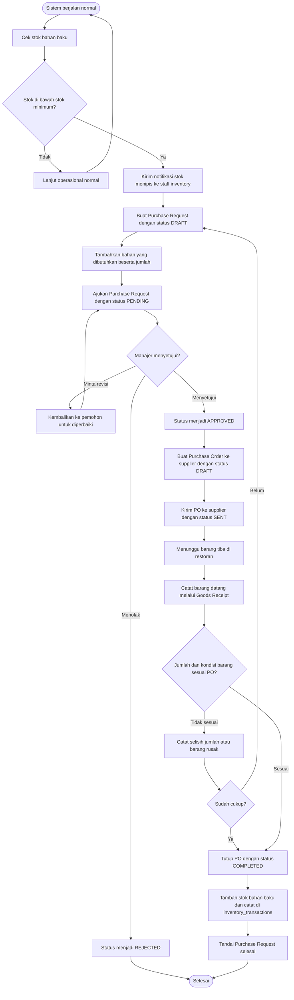

# Activity Diagram - Procurement (KONSEPTUAL - Fase 5)

> **STATUS: BELUM DIIMPLEMENTASIKAN**
>
> Diagram ini disusun dari blueprint sebagai rancangan Phase 5. Tabel
> `suppliers`, `purchase_requests`, `purchase_orders`, dan `goods_receipts`
> **belum dibuat** pada Fase 1-3. Modul ini juga bergantung pada tabel
> `ingredients` dan `inventory_transactions` yang dibangun di Fase 4.
>
> Bagian ini menjadi panduan saat mengembangkan Procurement nanti.

## Alur Konseptual



## Entitas yang Akan Dibutuhkan

```text
suppliers
    id, name, contact_name, phone, email, address,
    status (ACTIVE / INACTIVE), created_at

purchase_requests
    id, request_number, requested_by, approved_by,
    status (DRAFT / PENDING / APPROVED / REJECTED / COMPLETED),
    total_estimate, note, created_at, approved_at

purchase_request_items
    id, purchase_request_id, ingredient_id,
    quantity_requested, quantity_received, unit_price, note

purchase_orders
    id, po_number, purchase_request_id, supplier_id,
    status (DRAFT / SENT / PARTIAL / COMPLETED / CANCELLED),
    total_amount, expected_date, created_at

purchase_order_items
    id, purchase_order_id, ingredient_id,
    quantity_ordered, quantity_received, unit_price

goods_receipts
    id, receipt_number, purchase_order_id, received_by,
    received_at, note

inventory_transactions
    id, ingredient_id, type (PURCHASE / SALE / ADJUSTMENT / OPNAME / WASTE),
    quantity_in, quantity_out, reference_type, reference_id, note
```

## Aturan Bisnis

| Aturan | Penjelasan |
|---|---|
| Hanya manager yang menyetujui | `approved_by` hanya boleh diisi user dengan role `MANAGER` |
| PO wajib merujuk PR | `purchase_order.purchase_request_id` tidak boleh kosong |
| Stok hanya bertambah lewat Goods Receipt | Dilarang menambah stok langsung dari layar PO |
| Barang melebihi PO | Harus dicatat sebagai selisih, tidak boleh diterima diam-diam |
| Audit trail | Setiap perubahan status tercatat di tabel `audit_logs` |

## Urutan Status Purchase Request

```text
DRAFT -> PENDING -> APPROVED -> COMPLETED
   |         |          |
   |         +---------> REJECTED
   +--> (dibatalkan)
```

## Urutan Status Purchase Order

```text
DRAFT -> SENT -> PARTIAL -> COMPLETED
   |        |         |
   |        +---------> CANCELLED
   +--> (dihapus sebelum dikirim)
```

## Dependensi Fase 4

Modul ini tidak bisa dikerjakan sebelum tabel berikut tersedia (Fase 4):

| Tabel | Alasan |
|---|---|
| `ingredients` | Master data bahan baku |
| `recipe_items` | Relasi produk dengan bahan (BOM), sumber kebutuhan pembelian |
| `inventory_transactions` | Mencatat setiap pergerakan stok masuk dan keluar |
| `stock_opnames` | Hasil hitung fisik untuk rekonsiliasi |

Pembelian bahan baku muncul sebagai kebutuhan ketika penjualan terus
mengurangi stok hingga menyentuh titik minimum. Inilah jembatan antara Fase 4
(Inventory) dan Fase 5 (Procurement).
