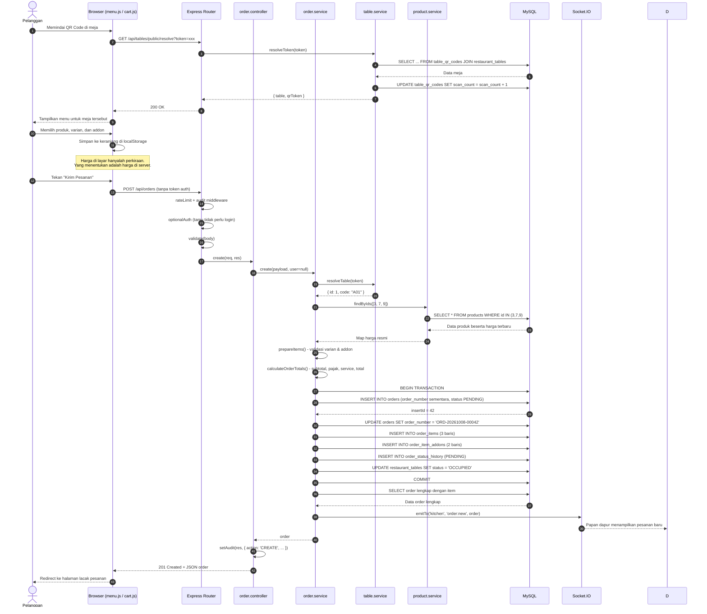

# Sequence Diagram - Customer Order (QR)

Alur lengkap dari pelanggan memindai QR hingga pesanan tercatat di dapur.
Berfokus pada interaksi antara browser, API Express, service, dan MySQL.

## Diagram



## Catatan Penting

### Harga Tidak Pernah Dipercaya dari Client

Payload yang dikirim frontend hanya berisi `product_id`, `variant_id`, `quantity`,
dan `addons`. **Tidak ada `price` di dalamnya.** `order.service.prepareItems()`
mengambil harga dari `product.service.findByIds()` setiap kali order dibuat.

Kalau ada yang mencoba mengirim `price: 1`, nilai tersebut diabaikan begitu saja.

### Satu Transaksi Database

Seluruh pembuatan order dibungkus `withTransaction()`:

```js
return withTransaction(async (conn) => {
  // insert order
  // update order_number
  // insert order_items
  // insert order_item_addons
  // insert order_status_history
  // update table status
});
```

Bila salah satu query gagal, `rollback()` dijalankan sehingga tidak ada order
tanpa item atau item tanpa order.

### Nomor Order Anti Tabrakan

`order_number` berisi format `ORD-YYYYMMDD-00042` yang bergantung pada `id`.
Masalahnya, `id` baru diketahui setelah insert. Solusinya:

1. Insert dengan `order_number` sementara yang pasti unik (timestamp acak)
2. Update dengan nomor permanen berdasarkan `id` yang baru didapat

Cara ini bebas race condition, berbeda dengan pola `SELECT MAX(id) + 1`.

### Event Realtime

Setelah transaksi commit, service memancarkan event ke Socket.IO:

| Event | Ruang | Ditonton oleh |
|---|---|---|
| `order:new` | `kitchen` | Papan dapur, kasir |
| `order:new` | `table:A01` | Halaman menu meja tersebut |
| `notification:new` | semua koneksi | Notifikasi bell di halaman staff |

### Error yang Mungkin Terjadi

| Situasi | HTTP | Pesan |
|---|:-:|---|
| Token QR tidak valid | 400 | "QR meja tidak valid atau sudah dicabut." |
| Produk tidak ditemukan | 400 | "Produk #99 tidak ditemukan." |
| Produk sedang habis | 400 | "Produk '...' sedang kosong." |
| Varian bukan milik produk | 400 | "Varian yang dipilih tidak tersedia untuk produk ini." |
| Addon bukan milik produk | 400 | "Addon '...' tidak bisa dipilih untuk produk '...'." |
| Keranjang kosong | 400 | "Keranjang masih kosong." |
| Total tidak wajar | 400 | "Total order harus lebih besar dari nol." |