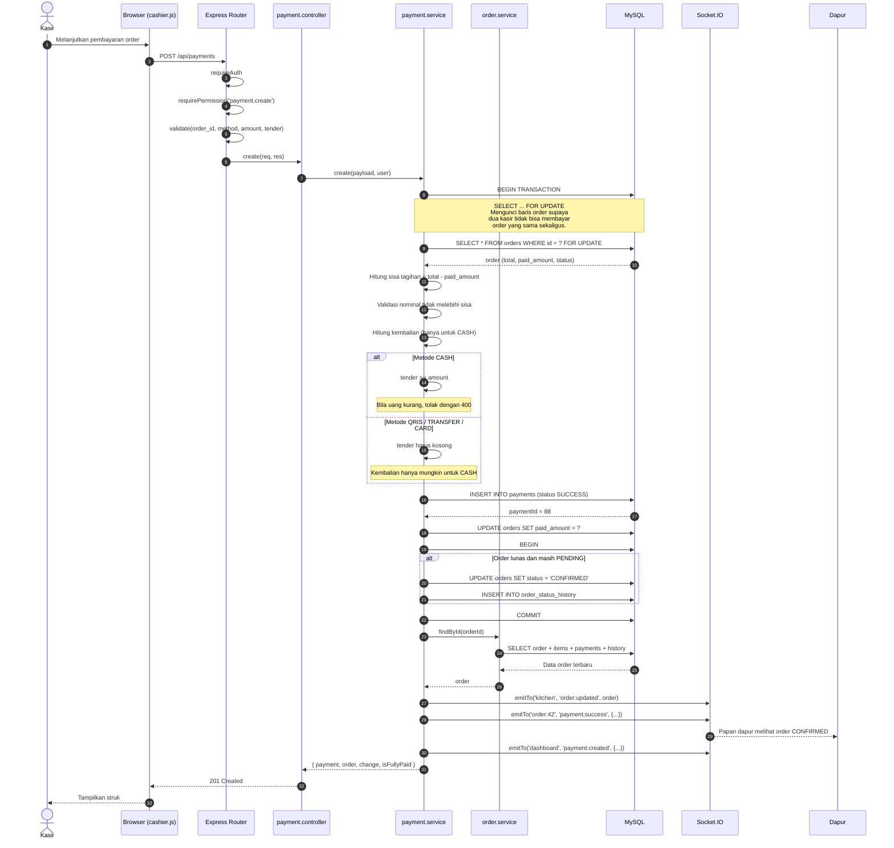
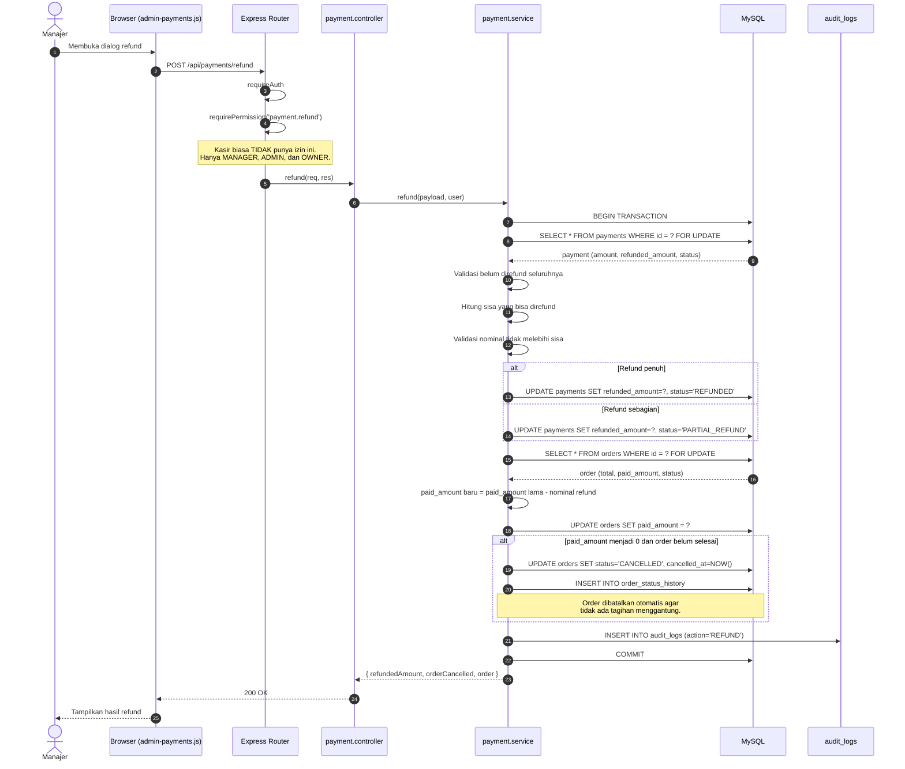

# Sequence Diagram - Payment (Simulasi)

Alur pencatatan pembayaran, validasi nominal, dan pembaruan status order.
Pada Fase 1-3 modul ini **bersifat simulasi** - tidak memanggil payment
gateway. Bentuk datanya sudah disiapkan agar integrasi gateway nanti tidak
mengubah skema tabel.

## Diagram: Pembayaran Berhasil



## Diagram: Refund



## Peran Fase 1-3: Simulasi, Bukan Gateway

| Yang Sudah Ada | Yang Belum (Perlu Saat Integrasi) |
|---|---|
| Kolom `method` untuk 4 metode | Verifikasi signature webhook provider |
| Kolom `reference` untuk id transaksi provider | Idempotency key agar webhook dobel tidak dikreditkan |
| Kolom `status` termasuk `PENDING` | Alur create -> webhook konfirmasi |
| Riwayat refund per baris | Pengembalian dana otomatis ke customer |
| Validasi nominal di server | Rekonsiliasi mutasi bank |

Kolom sudah disiapkan sekarang supaya integrasi gateway nanti cukup menambah
layer verifikasi, **tanpa mengubah skema tabel**.

## Metode Pembayaran

| Method | Kembalian | Verifikasi | Catatan |
|---|:-:|:-:|---|
| `CASH` | Ya | Langsung | Kembalian dihitung dari `tender - amount` |
| `QRIS` | Tidak | Simulasi | Dicatat sebagai SUCCESS langsung |
| `TRANSFER` | Tidak | Simulasi | Referensi transaksi dicatat manual |
| `CARD` | Tidak | Simulasi | Dicatat sebagai SUCCESS langsung |

## Status Pembayaran

```text
PENDING -> SUCCESS -> PARTIAL_REFUND -> REFUNDED
                    \-> REFUNDED
                    \-> FAILED
```

| Status | Arti |
|---|---|
| `PENDING` | Menunggu konfirmasi (belum dipakai di Fase 1-3) |
| `SUCCESS` | Pembayaran diterima |
| `PARTIAL_REFUND` | Sudah direfund sebagian |
| `REFUNDED` | Sudah direfund seluruhnya |
| `FAILED` | Gagal (disiapkan untuk integrasi gateway) |

## Aturan Penting

1. **Tidak ada pembayaran melebihi sisa tagihan.** Server menolak dengan 400.
2. **CASH boleh punya kembalian, selain itu tidak.** Mengirim `tender` dengan
   metode non-CASH akan ditolak.
3. **Order lunas otomatis menjadi CONFIRMED.** Menghemat langkah kasir.
4. **Order dengan `paid_amount` 0 otomatis dibatalkan saat refund penuh.**
5. **Semua refund tercatat di `audit_logs`**, termasuk alasan refund.
