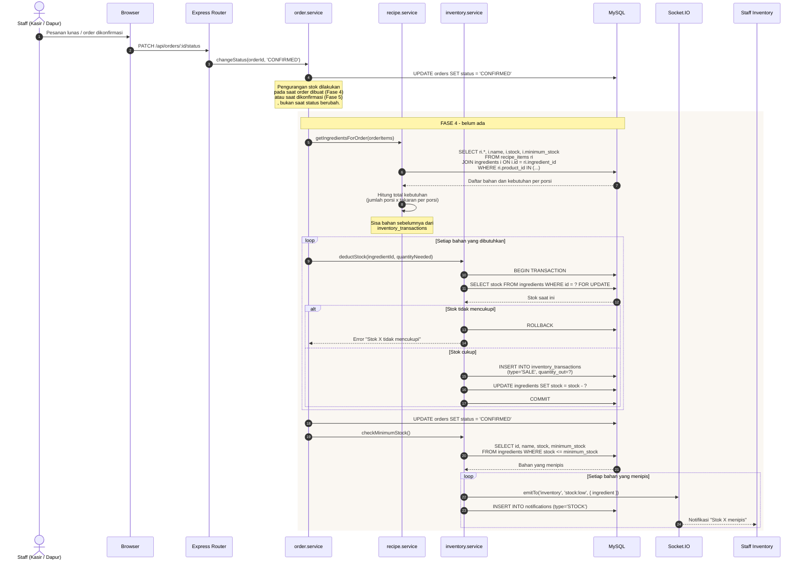

# Sequence Diagram - Inventory Deduction (KONSEPTUAL - Fase 4)

> **STATUS: BELUM DIIMPLEMENTASIKAN**
>
> Pada Fase 1-3, penjualan produk **tidak** mengurangi stok bahan baku karena
> tabel `ingredients`, `recipes`, dan `recipe_items` belum ada. Yang sudah
> diimplementasikan hanyalah penandaan produk sebagai `AVAILABLE` /
> `UNAVAILABLE` secara manual.
>
> Diagram ini merancang mekanisme pengurangan stok otomatis yang akan dibangun
> di Fase 4.

## Kenapa Stok Bahan Perlu Recipe / BOM?

Stok produk jadi (Nasi Goreng) sebenarnya berasal dari beberapa bahan baku:

```text
Product: Nasi Goreng Spesial
    ├── Rice        = 150 gram
    ├── Egg         = 1 pcs
    ├── Chicken     = 50 gram
    ├── Cooking Oil = 10 ml
    └── Seasoning   = 5 gram
```

Tanpa relasi ini, sistem hanya tahu "Nasi Goreng terjual 3 porsi" dan tidak
Tahu berapa kilogram Rice yang seharusnya berkurang.

## Diagram Konseptual



## Tabel yang Akan Dibutuhkan (Fase 4)

```text
ingredients
    id, name, code, unit (gram/ml/pcs),
    stock DECIMAL(12,3), minimum_stock DECIMAL(12,3),
    unit_price, supplier_id,
    status (ACTIVE/INACTIVE), created_at

recipes
    id, product_id, name,
    yield_quantity DECIMAL(12,3),
    note, created_at

recipe_items
    id, recipe_id, ingredient_id,
    quantity DECIMAL(12,3),
    unit, waste_percent DECIMAL(5,2) DEFAULT 0

inventory_transactions
    id, ingredient_id,
    type ENUM('PURCHASE','SALE','ADJUSTMENT','OPNAME','WASTE','VOID'),
    quantity_in DECIMAL(12,3),
    quantity_out DECIMAL(12,3),
    reference_type VARCHAR(30),
    reference_id BIGINT UNSIGNED,
    note VARCHAR(255),
    created_by BIGINT UNSIGNED,
    created_at

stock_opnames
    id, opname_number, status (DRAFT/APPROVED/CANCELLED),
    note, created_by, approved_by, created_at

stock_opname_items
    id, stock_opname_id, ingredient_id,
    system_stock, physical_stock, difference
```

## Perhitungan Waste

Masakan tidak pernah memakai 100% bahan. `waste_percent` di recipe_items
memambahkan penyangga:

```text
Kebutuhan riil   = quantity_resep x jumlah_porsi
KebutuhanEfektif = kebutuhan_riil x (1 + waste_percent / 100)

Contoh:
    Resep: Cooking Oil 10 ml per porsi
    Waste: 5%
    Terjual: 20 porsi

    Kebutuhan riil    = 10 x 20            = 200 ml
    Kebutuhan efektif  = 200 x (1 + 0.05)   = 210 ml
```

## Jenis Inventory Transaction

| Type | Arah | Kapan Terjadi |
|---|---|---|
| `PURCHASE` | Masuk | Barang diterima dari supplier (Fase 5) |
| `SALE` | Keluar | Produk terjual ke pelanggan |
| `ADJUSTMENT` | Masuk/Keluar | Penyesuaian manual oleh staff |
| `OPNAME` | Masuk/Keluar | Hasil hitung fisik |
| `WASTE` | Keluar | Bahan hilang/rusak |
| `VOID` | Balik | Pembatalan order mengembalikan stok |

## Kendala yang Harus Diperhatikan

| Kendala | Solusi |
|---|---|
| Dua kasir menjual bahan yang sama bersamaan | `SELECT ... FOR UPDATE` pada baris `ingredients` |
| Order dibatalkan setelah stok berkurang | Tipe `VOID` mengembalikan jumlah stok |
| Resep diubah setelah produk terjual | Stok historis tidak berubah karena `inventory_transactions` sudah frozen |
| Stok minus karena pembulatan | `DECIMAL(12,3)` untuk jumlah, bukan `INT` |
| Pemotongan stok gagal di tengah jalan | Satu transaksi untuk seluruh bahan dalam satu order |
