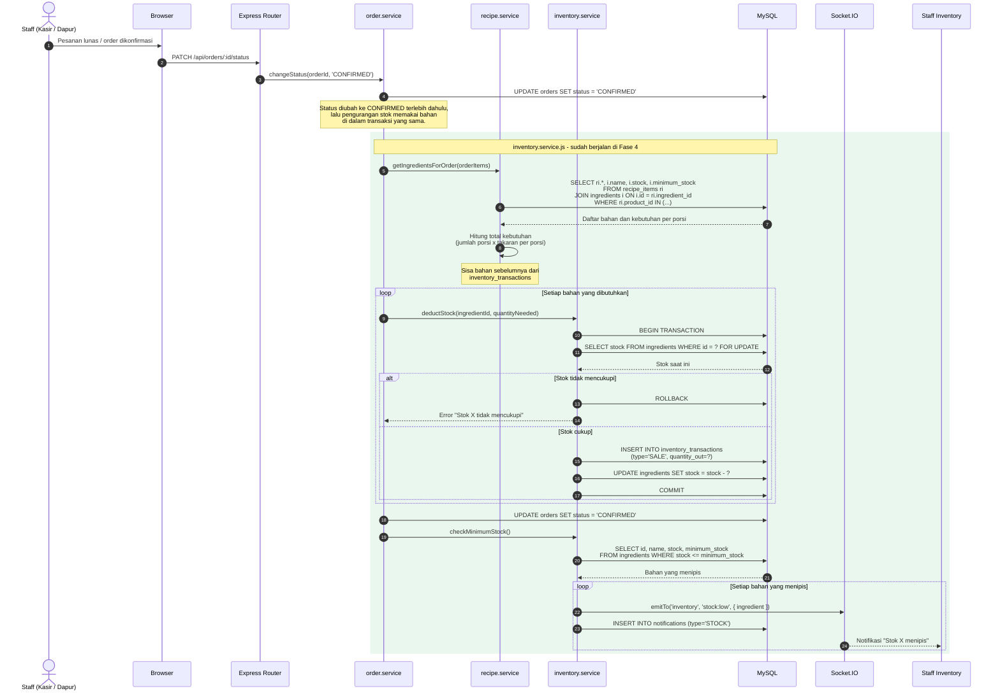

# Sequence Diagram - Inventory Deduction (Fase 4 - SUDAH DIIMPLEMENTASIKAN)

> **STATUS: SUDAH DIIMPLEMENTASIKAN**
>
> Pengurangan stok bahan baku otomatis sudah berjalan. Tabel `ingredients`,
> `recipes`, `recipe_items`, `inventory_transactions`, `stock_opnames`, dan
> `stock_opname_items` dibuat pada Fase 4.
>
> Perbedaan penting dari rancangan awal: stok **tidak** dikurangi saat order
> dibuat, melainkan saat order berstatus **CONFIRMED**. Alasannya dijelaskan di
> bagian "Kapan Stok Dikurangi".

## Kapan Stok Dikurangi

```text
Order dibuat (PENDING)  ->  stok BELUM berubah
Order lunas dibayar     ->  status CONFIRMED, stok KELUAR
Order dibatalkan / void ->  status CANCELLED, stok KEMBALI
```

Alasannya:

1. **Order yang batal sebelum dibayar tidak pernah memakai bahan.** Kalau stok
   langsung keluar saat order dibuat, order yang lalu di-void akan sia-sia
   walaupun bahan sebenarnya masih ada di dapur.
2. **Satu transaksi.** Pengurangan stok berjalan di dalam transaksi database
   yang sama dengan perubahan status, sehingga keduanya tidak bisa tidak sinkron.
3. **Order QR belum tentu dibayar.** Tamu bisa membuat order lalu meninggalkannya.

## Kenapa Stok Bahan Perlu Recipe / BOM?

Stok produk jadi (Nasi Goreng) sebenarnya berasal dari beberapa bahan baku:

```text
Product: Nasi Goreng Spesial (1 porsi)
    ├── Beras Pulen   = 0.150 kg (waste 2%)
    ├── Telur Ayam    = 1 pcs
    ├── Ayam Potong   = 0.050 kg (waste 10%)
    ├── Minyak Goreng = 0.010 liter
    └── Bumbu Rujak   = 15 gram (waste 5%)
```

Tanpa relasi ini, sistem hanya tahu "Nasi Goreng terjual 3 porsi" dan tidak
tahu berapa kilogram beras yang seharusnya berkurang.

> **Penting:** takaran recipe memakai satuan yang sama dengan satuan bahan.
> Beras bersatuan `kg`, jadi 0.150 berarti 150 gram. Menulis 150 untuk bahan
> `kg` berarti 150 **kilogram** per porsi - kesalahan ini sempat terhima oleh
> seed dan sekarang dijaga oleh pengujian.



## Tabel yang Digunakan (Fase 4)

Semua tabel di bawah sudah ada di `database/schema.sql`. Skema resminya
mengadecimal jumlah dengan 3 angka (`DECIMAL(12,3)`) dan menyimpan
`unit` sebagai varchar agar satuan bebas (`kg`, `gram`, `pcs`, `liter`).

```text
ingredients
    id, code VARCHAR(30) UNIQUE, name VARCHAR(150),
    unit ENUM('gram','kg','ml','liter','pcs','pack','bottle','cans'),
    stock DECIMAL(12,3), minimum_stock DECIMAL(12,3),
    unit_price DECIMAL(15,2), supplier_id BIGINT UNSIGNED NULL,
    is_active TINYINT(1), created_at, updated_at

recipes
    id, product_id BIGINT UNSIGNED UNIQUE,
    name VARCHAR(150), yield_quantity DECIMAL(12,3),
    note VARCHAR(500), is_active TINYINT(1),
    created_at, updated_at

recipe_items
    id, recipe_id, ingredient_id,
    quantity DECIMAL(12,3),          -- dalam satuan ingredients.unit
    waste_percent DECIMAL(5,2) DEFAULT 0,
    note VARCHAR(255),
    UNIQUE (recipe_id, ingredient_id)

inventory_transactions
    id, ingredient_id,
    type ENUM('PURCHASE','SALE','ADJUSTMENT','OPNAME','WASTE','VOID','RETURN'),
    quantity_in DECIMAL(12,3),
    quantity_out DECIMAL(12,3),
    stock_before DECIMAL(12,3),      -- snapshot sebelum mutasi
    stock_after DECIMAL(12,3),       -- snapshot sesudah mutasi
    reference_type VARCHAR(30), reference_id BIGINT UNSIGNED,
    order_id BIGINT UNSIGNED NULL,   -- pengaman agar VOID tidak dobel
    note VARCHAR(255), created_by BIGINT UNSIGNED, created_at

stock_opnames
    id, opname_number VARCHAR(30) UNIQUE,
    status ENUM('DRAFT','APPROVED','CANCELLED'),
    note VARCHAR(500), created_by, approved_by,
    created_at, approved_at

stock_opname_items
    id, stock_opname_id, ingredient_id,
    system_stock DECIMAL(12,3),
    physical_stock DECIMAL(12,3) NULL,  -- NULL selama opname masih DRAFT
    difference DECIMAL(12,3),
    note VARCHAR(255)
```

> **Catatan satuan:** `recipe_items` sengaja tidak punya kolom `unit`.
> Quantity pada recipe selalu dinyatakan dalam satuan bahan induknya
> (`ingredients.unit`), jadi tidak ada lagi yang bisa salah konversi. Saat
> perbandingan atau penjumlahan antar bahan, `ingredient.service.js`
> mengonversi ke satuan dasar lewat `toBaseUnit()` (`kg` -> `gram`,
> `liter` -> `ml`), bukan menyimpan satuan ganda di database.

> **Wajib dibaca sebelum mengubah skema:** `inventory_transactions.stock_before`
> dan `stock_after` adalah snapshot, bukan kolom yang dihitung ulang. Nilainya
> harus selalu cocok dengan `ingredients.stock` saat itu, dan itu dijaga oleh
> test "stok bahan selalu cocok dengan jurnal mutasi".

## Perhitungan Waste

Masakan tidak pernah memakai 100% bahan. `waste_percent` di recipe_items
memambahkan penyangga:

```text
Kebutuhan riil   = quantity_resep x jumlah_porsi
KebutuhanEfektif = kebutuhan_riil x (1 + waste_percent / 100)

Contoh:
    Resep: Cooking Oil 10 ml per porsi
    Waste: 5%
    Terjual: 20 porsi

    Kebutuhan riil    = 10 x 20            = 200 ml
    Kebutuhan efektif  = 200 x (1 + 0.05)   = 210 ml
```

## Jenis Inventory Transaction

| Type | Arah | Kapan Terjadi |
|---|---|---|
| `PURCHASE` | Masuk | Barang diterima dari supplier (`POST /api/inventory/receive`) |
| `SALE` | Keluar | Order masuk status `CONFIRMED` |
| `ADJUSTMENT` | Masuk/Keluar | Penyesuaian manual oleh staff (`POST /api/inventory/adjustment`) |
| `OPNAME` | Masuk/Keluar | Hasil hitung fisik saat opname disetujui |
| `WASTE` | Keluar | Bahan hilang/rusak (`POST /api/inventory/movements`) |
| `VOID` | Balik | Order dibatalkan mengembalikan stok |
| `RETURN` | Masuk | Retur bahan dari dapur (`POST /api/inventory/movements`) |

`SALE`, `VOID`, `OPNAME`, `PURCHASE`, dan `ADJUSTMENT` **tidak bisa** dibuat
lewat endpoint mutasi karena masing-masing punya aturan sendiri. Endpoint
`/movements` hanya menerima `WASTE` dan `RETURN`; Percobaan memakai tipe lain
ditolak 400 dan tidak mengubah stok.

## Endpoint Inventory (Fase 4)

Semua endpoint berada di `/api/inventory` dan membutuhkan permission
`inventory.view` (baca) atau `inventory.manage` (tulis).

| Method | Endpoint | Fungsi |
|---|---|---|
| GET | `/ingredients` | Daftar bahan + pagination/filter |
| GET | `/ingredients/low-stock` | Bahan di bawah stok minimum |
| GET | `/ingredients/:id` | Detail bahan |
| POST | `/ingredients` | Tambah bahan |
| PUT | `/ingredients/:id` | Ubah bahan |
| DELETE | `/ingredients/:id` | Nonaktifkan bahan |
| GET | `/recipes` | Daftar recipe |
| GET | `/recipes/products/:productId` | Recipe satu produk |
| PUT | `/recipes/products/:productId` | Simpan recipe (BOM) |
| DELETE | `/recipes/products/:productId` | Hapus recipe |
| GET | `/summary` | Ringkasan nilai & jumlah stok |
| GET | `/movements` | Jurnal transaksi |
| POST | `/check-low-stock` | Pardon cek stok menipis |
| POST | `/adjustment` | Penyesuaian stok manual |
| POST | `/receive` | Penerimaan barang (PURCHASE) |
| POST | `/movements` | Catat WASTE (rusak) atau RETURN (retur dapur) |
| GET | `/opnames` | Daftar stock opname |
| POST | `/opnames` | Buat draft opname |
| GET | `/opnames/:id` | Detail opname |
| POST | `/opnames/:id/approve` | Setujui & terapkan ke stok |
| POST | `/opnames/:id/cancel` | Batalkan opname |
| PUT | `/opnames/:opnameId/items/:ingredientId` | Isi hasil hitung fisik |

UI: `frontend/admin-inventory.html` dengan tab Bahan, Recipe, Jurnal, dan
Opname. Menu ini muncul pada halaman utama bila pengguna memiliki permission
`inventory.view`.

## Kendala yang Sudah Diperhatikan

| Kendala | Solusi |
|---|---|
| Dua kasir menjual bahan yang sama bersamaan | `SELECT ... FOR UPDATE` pada baris `ingredients` |
| Order dibatalkan setelah stok berkurang | Tipe `VOID` mengembalikan jumlah stok |
| Resep diubah setelah produk terjual | Stok historis tidak berubah karena `inventory_transactions` sudah frozen |
| Stok minus karena pembulatan | `DECIMAL(12,3)` untuk jumlah, bukan `INT` |
| Pemotongan stok gagal di tengah jalan | Satu transaksi untuk seluruh bahan dalam satu order |
