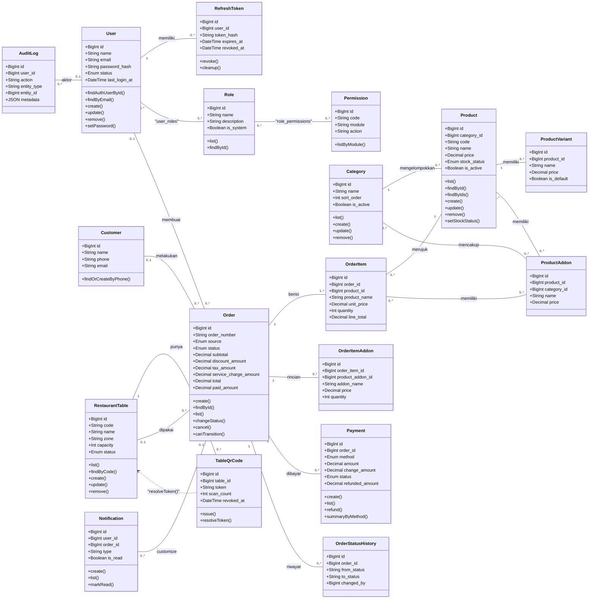
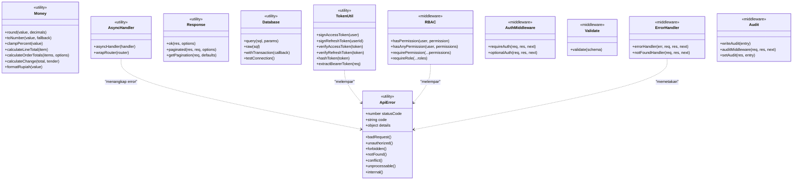
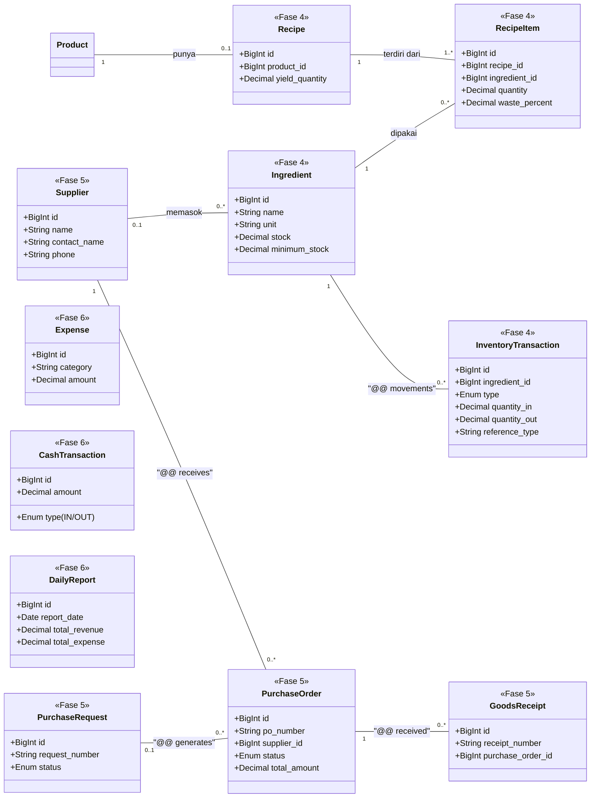

# Class Diagram - Smart Restaurant Management System

Diagram kelas untuk entity domain yang sudah diimplementasikan (Fase 1-3),
disertai kelas konseptual Fase 4-6.

## Domain yang Diimplementasikan (Fase 1-3)

## Utilitas dan Middleware

## Domain Konseptual (Fase 4-6)

## Catatan Desain Penting

| Keputusan | Alasan |
|---|---|
| Order menyimpan `product_name` dan `unit_price` sebagai snapshot | Struk lama tidak ikut berubah ketika harga produk atau aturan pajak diperbarui |
| `Order.soft delete` dihindari, memakai status `CANCELLED` | Menjaga integritas riwayat dan jejak audit |
| Produk yang sudah pernah dipesan tidak dihapus fisik (`ON DELETE RESTRICT`) | Melindungi integritas data transaksi |
| `hasPermission` dipanggil ulang di setiap request lewat `requireAuth` | Pencabutan permission langsung berlaku walau access token lama masih valid |
| Refresh token disimpan sebagai hash SHA-256 | Kalau database bocor, token curian tidak langsung bisa dipakai |
| Pembuatan order dibungkus `withTransaction` | Tidak ada order setengah jadi |
| Baris order dikunci `SELECT ... FOR UPDATE` saat pembayaran | Dua kasir tidak bisa membayar order yang sama sekaligus |