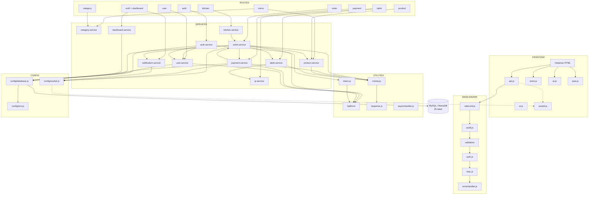

# Component Diagram - Smart Restaurant Management System

Gambaran modul penyusun sistem beserta dependensi antar modul.

## Arsitektur Lapisan

```text
┌───────────────────────────────────────────────────────────────┐
│ PRESENTASI - Frontend (HTML + CSS + Vanilla JS / PWA)         │
│                                                               │
│  Halaman HTML (13)  │  api.js  ui.js  store.js                │
│  index / login      │  socket.js  qr.js  pwa.js               │
│  menu / cart / order│                                         │
│  cashier / kitchen  │                                         │
│  dashboard / admin-*│                                         │
└───────────────────────────┬───────────────────────────────────┘
                            │ REST (fetch) + Socket.IO
┌───────────────────────────▼───────────────────────────────────┐
│ TRANSPORT - Express.js                                        │
│                                                               │
│  MIDDLEWARE: cors → json → security header → rateLimit         │
│              → audit → validate → auth → rbac                  │
│                                                               │
│  ROUTES → CONTROLLERS → SERVICES → DATABASE                    │
└───────────────────────────┬───────────────────────────────────┘
                            │ mysql2 (parameterized query)
┌───────────────────────────▼───────────────────────────────────┐
│ DATA - MariaDB 10.4 / MySQL 8                                  │
│  RBAC(6) │ Menu(4) │ Meja+QR(2) │ Order(5) │ Lain(3)         │
│  Total 20 tabel                                                │
└───────────────────────────────────────────────────────────────┘
```

## Diagram Komponen



## Tanggung Jawab Komponen

### Frontend

| Komponen | Tanggung Jawab |
|---|---|
| `api.js` | Menyisipkan header `Authorization`, membuka JSON, mencoba refresh token saat access token kedaluwarsa |
| `ui.js` | Toast, modal, konfirmasi, `escapeHtml`, format Rupiah, guard halaman |
| `store.js` | Keranjang di `localStorage` per meja, konversi ke payload order |
| `socket.js` | Koneksi realtime, auto-reconnect, join room |
| `qr.js` | Menampilkan gambar QR hasil render server |
| `pwa.js` | Registrasi service worker, prompt instalasi |

### Backend

| Layer | Tanggung Jawab |
|---|---|
| `config/env.js` | Membaca dan memvalidasi environment variable |
| `config/database.js` | Connection pool, `query`, `withTransaction` |
| `config/socket.js` | Menyimpan instance Socket.IO agar bisa dipakai service |
| `middleware/*` | Keamanan, validasi, audit, penanganan error |
| `routes/*` | Mendefinisikan URL, method, dan urutan middleware |
| `controllers/*` | Tipis: baca req, panggil service, kirim response |
| `services/*` | Seluruh logika bisnis dan query database |
| `utils/*` | Perhitungan uang, token, respons, error |

## Prinsip Dependency

Aturan yang dijaga agar kode tetap mudah dibaca:

1. **Controller tidak pernah menulis SQL.** Semua query ada di service.
2. **Service boleh memakai service lain**, tapi tidak boleh saling melingkar. Contoh:
   `order.service` memakai `product.service`, tetapi `product.service` tidak
   pernah memakai `order.service`.
3. **Route tidak boleh berisi logika bisnis**, hanya wiring.
4. **Utilitas tidak boleh tahu apa pun tentang database.**
5. **`errorHandler` dipasang paling akhir** di `app.js`.

## Library Eksternal

| Library | Dipakai Untuk | Alasan |
|---|---|---|
| `express` | Framework HTTP | Stabil dan sudah umum dipakai |
| `mysql2` | Driver database | Mendukung prepared statement |
| `bcryptjs` | Hash password | Pure JS, tidak butuh compiler native di Windows |
| `jsonwebtoken` | JWT | Standar de facto |
| `socket.io` | Realtime | Mendukung room, reconnect otomatis |
| `nanoid` | Token QR | Pendek, acak, aman |
| `qrcode` | Render QR PNG | Algoritma QR teruji, bukan ditulis sendiri |
| `express-rate-limit` | Rate limiting | Sudah teruji |
| `cors` | CORS | Standar |
| `dotenv` | Environment variable | Standar |
