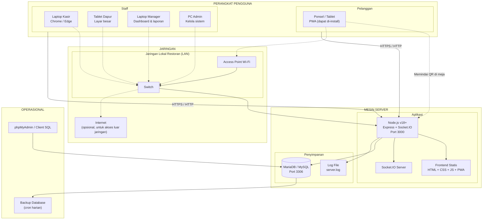
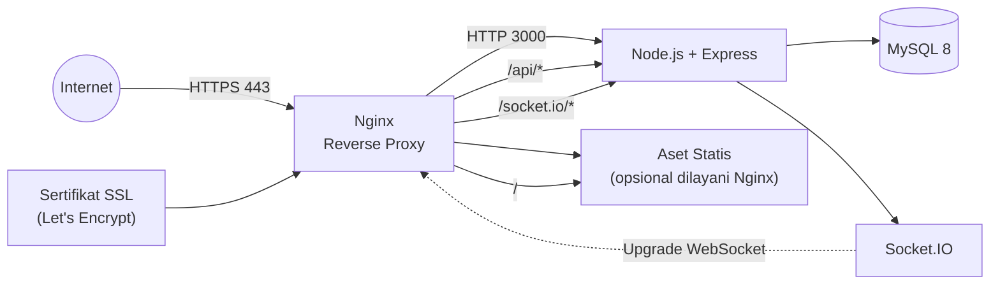

# Deployment Diagram - Smart Restaurant Management System

Gambaran lingkungan menjalankan sistem, termasuk perangkat yang dipakai
berbagai pihak dan jaringan yang menghubungkan semuanya.

## Topologi



## Komponen Deployment

| Komponen | Spesifikasi | Keterangan |
|---|---|---|
| **Node.js** | v18 atau lebih baru | Runtime JavaScript di sisi server |
| **Express.js** | 4.x | Menyediakan REST API dan menyajikan frontend |
| **Socket.IO** | 4.x | Realtime, berjalan di HTTP server yang sama |
| **MariaDB / MySQL** | MariaDB 10.4 atau MySQL 8 | Penyimpanan data |
| **Port HTTP** | 3000 (bisa diubah lewat `PORT`) | API dan frontend di port yang sama |
| **Port MySQL** | 3306 | Wajib lokal, tidak boleh dibuka ke publik |
| **RAM minimum** | 512 MB untuk Node + 512 MB untuk MySQL | Cukup untuk beberapa ribu order per hari |
| **Browser** | Chrome/Edge/Firefox/Safari versi modern | Butuh dukungan ES Module |

## Konfigurasi Jaringan

### QR Memerlukan Alamat yang Bisa Dicapai Pelanggan

| Situasi | Solusi |
|---|---|
| Restaurant & server dalam satu jaringan | `PUBLIC_BASE_URL=http://192.168.1.10:3000` |
| Pelanggan memakai data seluler | Butuh domain + HTTPS publik |
| Instalasi di komputer lokal | `PUBLIC_BASE_URL=http://localhost:3000` |

> **Penting:** QR memuat URL. Kalau alamat server hanya `localhost`, QR hanya
> bisa dipindai di komputer itu sendiri. Untuk penggunaan nyata, isi
> `PUBLIC_BASE_URL` dengan alamat yang bisa dijangkau perangkat pelanggan,
> misalnya IP LAN atau domain publik.

### Port yang Perlu Dibuka

| Port | Akses | Alasan |
|---|---|---|
| 3000 (TCP) | Jaringan lokal | HTTP dan WebSocket |
| 3306 (TCP) | **Hanya lokal** | Database tidak boleh terekspos |

## Deployment Produksi



### Checklist Produksi

| Item | Detail |
|---|---|
| HTTPS | Wajib. Token dan kredensial tidak boleh lewat HTTP |
| `NODE_ENV` | `production` |
| `JWT_ACCESS_SECRET` | String acak minimal 32 karakter |
| `JWT_REFRESH_SECRET` | String acak berbeda dari access secret |
| `DB_PASSWORD` | Password kuat, bukan kosong |
| `CORS_ORIGIN` | Hanya domain yang benar |
| Rate limit | Turunkan batasnya dari default bila perlu |
| Backup | Cron harian + simpan di lokasi berbeda |
| Log | Rotasi log harian |
| PM2 | Proces manager agar server otomatis restart |

### Membikin Secret

```bash
node -e "console.log(require('crypto').randomBytes(48).toString('hex'))"
```

Jalankan perintah itu dua kali untuk access secret dan refresh secret.

## Mode Pengembangan vs Produksi

| Aspek | Pengembangan (`NODE_ENV=development`) | Produksi (`NODE_ENV=production`) |
|---|---|---|
| Secret JWT | Boleh pakai nilai bawaan | Wajib diisi, minimal 32 karakter |
| Pesan error 500 | Termasuk stack trace | Hanya pesan generik |
| Config tidak valid | Peringatan di console | Server menolak jalan |
| Akses log | Driver StrictWarning aktif | Tidak ada warning |

## Strategi Backup

```bash
# Backup harian jam 2 pagi (Windows Task Scheduler / cron Linux)
mysqldump -u root -p restaurant_management > backup-$(date +\%Y\%m\%d).sql

# Memulihkan
mysql -u root -p restaurant_management < backup-20261008.sql
```

Saran:

- Simpan minimal 7 backup terakhir
- Simpan satu salinan di lokasi berbeda (misalnya cloud)
- Uji proses restore secara berkala, backup yang tak pernah diuji sering rusak

## Catatan Docker

Blueprint asli menyertakan `docker-compose.yml`, namun **tidak disertakan pada
versi ini** karena Docker tidak terinstal pada mesin pengembangan. Kalau
nantinya Docker tersedia, tambahkan:

```yaml
services:
  mysql:
    image: mysql:8.0
    environment:
      MYSQL_DATABASE: restaurant_management
      MYSQL_USER: restaurant_user
      MYSQL_PASSWORD: restaurant_password
      MYSQL_ROOT_PASSWORD: root_password
    ports:
      - "3306:3306"
    volumes:
      - mysql_data:/var/lib/mysql

  backend:
    build: ./backend
    ports:
      - "3000:3000"
    environment:
      - NODE_ENV=production
      - DB_HOST=mysql
      - DB_USER=restaurant_user
      - DB_PASSWORD=restaurant_password
      - DB_NAME=restaurant_management
    depends_on:
      - mysql

volumes:
  mysql_data:
```