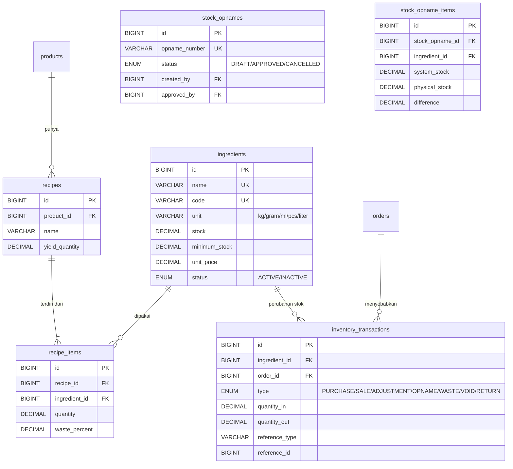
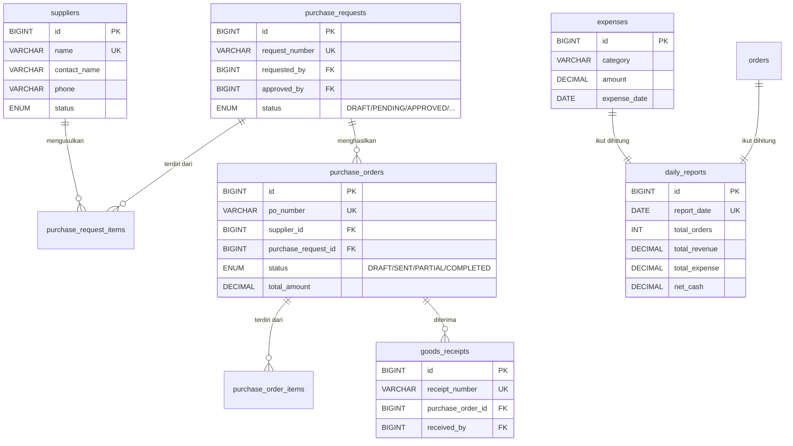

# ERD - Entity Relationship Diagram

Hubungan antar tabel pada database `restaurant_management`.

## Ringkasan Tabel

| Kategori | Tabel | Jumlah |
|---|---|:-:|
| RBAC & Autentikasi | `users`, `roles`, `permissions`, `role_permissions`, `user_roles`, `refresh_tokens` | 6 |
| Pelanggan | `customers` | 1 |
| Menu | `categories`, `products`, `product_variants`, `product_addons` | 4 |
| Meja & QR | `restaurant_tables`, `table_qr_codes` | 2 |
| Order | `orders`, `order_items`, `order_item_addons`, `order_status_history` | 4 |
| Pembayaran | `payments` | 1 |
| Sistem | `notifications`, `audit_logs` | 2 |
| Inventory | `ingredients`, `recipes`, `recipe_items`, `inventory_transactions`, `stock_opnames`, `stock_opname_items` | 6 |
| | **Total (Fase 1-4)** | **26** |

## ERD Lengkap

```mermaid
erDiagram
    %% ============ RBAC ============
    users ||--o{ user_roles : "memiliki"
    roles ||--o{ user_roles : "diberikan"
    roles ||--o{ role_permissions : "memiliki"
    permissions ||--o{ role_permissions : "diberikan ke"
    users ||--o{ refresh_tokens : "memiliki sesi"

    users {
        BIGINT id PK
        VARCHAR name
        VARCHAR email UK
        VARCHAR phone
        VARCHAR password_hash
        ENUM status "ACTIVE / INACTIVE"
        TINYINT must_change_password
        DATETIME last_login_at
        DATETIME created_at
    }

    roles {
        BIGINT id PK
        VARCHAR name UK
        VARCHAR description
        TINYINT is_system
    }

    permissions {
        BIGINT id PK
        VARCHAR code UK "order.create"
        VARCHAR module
        VARCHAR action
    }

    user_roles {
        BIGINT user_id PK,FK
        BIGINT role_id PK,FK
        DATETIME assigned_at
    }

    role_permissions {
        BIGINT role_id PK,FK
        BIGINT permission_id PK,FK
    }

    refresh_tokens {
        BIGINT id PK
        BIGINT user_id FK
        CHAR token_hash UK "SHA-256"
        DATETIME expires_at
        DATETIME revoked_at
    }

    %% ============ Pelanggan ============
    customers ||--o{ orders : "melakukan"

    customers {
        BIGINT id PK
        VARCHAR name
        VARCHAR phone
        VARCHAR email UK
    }

    %% ============ Menu ============
    categories ||--o{ products : "mengelompokkan"
    products ||--o{ product_variants : "memiliki"
    products ||--o{ product_addons : "memiliki"
    categories ||--o{ product_addons : "mencakup"

    categories {
        BIGINT id PK
        VARCHAR name UK
        VARCHAR description
        INT sort_order
        TINYINT is_active
    }

    products {
        BIGINT id PK
        BIGINT category_id FK
        VARCHAR code UK
        VARCHAR name
        VARCHAR description
        DECIMAL price
        VARCHAR image_url
        ENUM stock_status "AVAILABLE / UNAVAILABLE"
        TINYINT is_active
        INT sort_order
    }

    product_variants {
        BIGINT id PK
        BIGINT product_id FK
        VARCHAR name
        DECIMAL price "NULL = harga produk"
        TINYINT is_default
        TINYINT is_active
    }

    product_addons {
        BIGINT id PK
        BIGINT product_id FK "NULL jika per kategori"
        BIGINT category_id FK "NULL jika per produk"
        VARCHAR name
        DECIMAL price
        TINYINT is_active
    }

    %% ============ Meja & QR ============
    restaurant_tables ||--o{ table_qr_codes : "mempunyai"

    restaurant_tables {
        BIGINT id PK
        VARCHAR code UK "A01"
        VARCHAR name
        VARCHAR zone
        INT capacity
        ENUM status "AVAILABLE/OCCUPIED/RESERVED/DISABLED"
        TINYINT is_active
    }

    table_qr_codes {
        BIGINT id PK
        BIGINT table_id FK
        VARCHAR token UK "32 char acak"
        VARCHAR label
        TINYINT is_active
        INT scan_count
        DATETIME revoked_at
    }

    %% ============ Order ============
    restaurant_tables ||--o{ orders : "dipakai"
    customers ||--o{ orders : "melakukan"
    users ||--o{ orders : "membuat"
    orders ||--|{ order_items : "berisi"
    orders ||--o{ payments : "dibayar"
    orders ||--o{ order_status_history : "riwayat"
    orders ||--o{ notifications : "kabar"

    orders {
        BIGINT id PK
        VARCHAR order_number UK "ORD-YYYYMMDD-00001"
        ENUM source "QR / POS"
        BIGINT table_id FK
        BIGINT customer_id FK
        BIGINT created_by FK
        ENUM status "PENDING..COMPLETED/CANCELLED"
        DECIMAL subtotal
        DECIMAL discount_percent
        DECIMAL discount_amount
        DECIMAL tax_percent
        DECIMAL tax_amount
        DECIMAL service_charge_percent
        DECIMAL service_charge_amount
        DECIMAL total
        DECIMAL paid_amount
        VARCHAR note
        DATETIME cancelled_at
        DATETIME completed_at
        DATETIME created_at
    }

    order_items {
        BIGINT id PK
        BIGINT order_id FK
        BIGINT product_id FK
        VARCHAR product_name "snapshot"
        VARCHAR product_code "snapshot"
        BIGINT variant_id FK
        VARCHAR variant_name "snapshot"
        DECIMAL unit_price "snapshot"
        INT quantity
        DECIMAL line_total
        VARCHAR note
    }

    order_items ||--o{ order_item_addons : "rincian"

    order_item_addons {
        BIGINT id PK
        BIGINT order_item_id FK
        BIGINT product_addon_id FK
        VARCHAR addon_name "snapshot"
        DECIMAL price "snapshot"
        INT quantity
        DECIMAL line_total
    }

    order_status_history {
        BIGINT id PK
        BIGINT order_id FK
        VARCHAR from_status
        VARCHAR to_status
        BIGINT changed_by FK
        VARCHAR note
        DATETIME created_at
    }

    %% ============ Pembayaran ============
    users ||--o{ payments : "menerima"

    payments {
        BIGINT id PK
        BIGINT order_id FK
        ENUM method "CASH/TRANSFER/QRIS/CARD"
        DECIMAL amount
        DECIMAL change_amount
        ENUM status "PENDING/SUCCESS/..."
        DECIMAL refunded_amount
        VARCHAR reference
        BIGINT paid_by FK
        DATETIME paid_at
    }

    %% ============ Sistem ============
    users ||--o{ notifications : "menerima"
    users ||--o{ audit_logs : "aktor"

    notifications {
        BIGINT id PK
        BIGINT user_id FK "NULL = broadcast"
        BIGINT order_id FK
        VARCHAR type
        VARCHAR title
        VARCHAR message
        TINYINT is_read
        DATETIME created_at
    }

    audit_logs {
        BIGINT id PK
        BIGINT user_id FK
        VARCHAR action
        VARCHAR entity_type
        BIGINT entity_id
        VARCHAR description
        JSON metadata
        VARCHAR ip_address
        VARCHAR user_agent
        DATETIME created_at
    }
```



## Aturan `ON DELETE`

| Relasi | ON DELETE | Alasan |
|---|---|---|
| `user_roles` → `users` | CASCADE | Role ikut hilang saat user dihapus |
| `user_roles` → `roles` | CASCADE | Sama |
| `role_permissions` → `roles` | CASCADE | Permission ikut hilang |
| `table_qr_codes` → `restaurant_tables` | CASCADE | QR tidak berguna tanpa meja |
| `order_items` → `orders` | CASCADE | Item tidak ada tanpa order |
| `order_item_addons` → `order_items` | CASCADE | Rincian tidak ada tanpa item |
| `order_status_history` → `orders` | CASCADE | Riwayat tidak ada tanpa order |
| `products` → `categories` | RESTRICT | Cegah kategori tanpa produk hilang diam-diam |
| `order_items` → `products` | RESTRICT | Jaga integritas riwayat transaksi |
| `order_item_addons` → `product_addons` | RESTRICT | Sama |
| `payments` → `orders` | RESTRICT | Pembayaran tidak boleh hilang |
| `orders` → `restaurant_tables` | SET NULL | Meja dihapus, riwayat order tetap ada |
| `audit_logs` → `users` | SET NULL | Log tetap ada walau user dihapus |

## Konvensi Snapshot

Order menyimpan salinan nilai saat transaksi terjadi. Ini disengaja.

```text
order_items.product_name    <- salinan dari products.name
order_items.product_code    <- salinan dari products.code
order_items.unit_price      <- salinan dari products.price
order_items.variant_name    <- salinan dari product_variants.name
order_item_addons.addon_name <- salinan dari product_addons.name
order_item_addons.price      <- salinan dari product_addons.price
```

**Alasan:** struk dari bulan lalu harus tetap menampilkan nama dan harga yang
benar, walaupun produknya sudah diganti nama atau harganya sudah dinaikkan.

## Tabel Inventory (Fase 4 - Sudah Ada)

Enam tabel di bawah sudah dibuat di `database/schema.sql` dan dipakai oleh
`backend/services/inventory.service.js`. Stok bahan hanya boleh diubah lewat
service tersebut agar setiap perubahan selalu punya jurnal.



Relasi detail:

```text
products 1 --- 0..1 recipes
recipes  1 --- 1..* recipe_items
ingredients 1 --- 0..* recipe_items
ingredients 1 --- 0..* inventory_transactions
orders 1 --- 0..* inventory_transactions
ingredients 1 --- 0..* stock_opname_items
stock_opnames 1 --- 1..* stock_opname_items
```

## Tabel Procurement & Finance (Fase 5-6 - Belum Ada)

Rancangan tabel untuk pembelian dari supplier, penerimaan barang, dan laporan
keuangan. Belum ada di `database/schema.sql`.



## Indeks Penting

Indeks yang paling sering dibutuhkan agar query cepat:

| Tabel | Indeks | Untuk |
|---|---|---|
| `orders` | `(status, created_at)` | Daftar order per status dan tanggal |
| `orders` | `(table_id)` | Cari order aktif per meja |
| `orders` | `(created_at)` | Laporan harian |
| `order_items` | `(order_id)` | Ambil item sebuah order |
| `order_items` | `(product_id)` | Laporan produk terlaris |
| `products` | `(category_id)` | Saring menu per kategori |
| `products` | `(is_active, stock_status)` | Menu pelanggan yang tersedia |
| `payments` | `(paid_at)` | Rekap penjualan harian |
| `users` | `(email)` UNIQUE | Login |
| `table_qr_codes` | `(token)` UNIQUE | Resolusi QR saat dipindai |